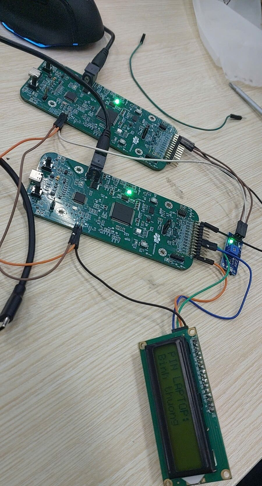
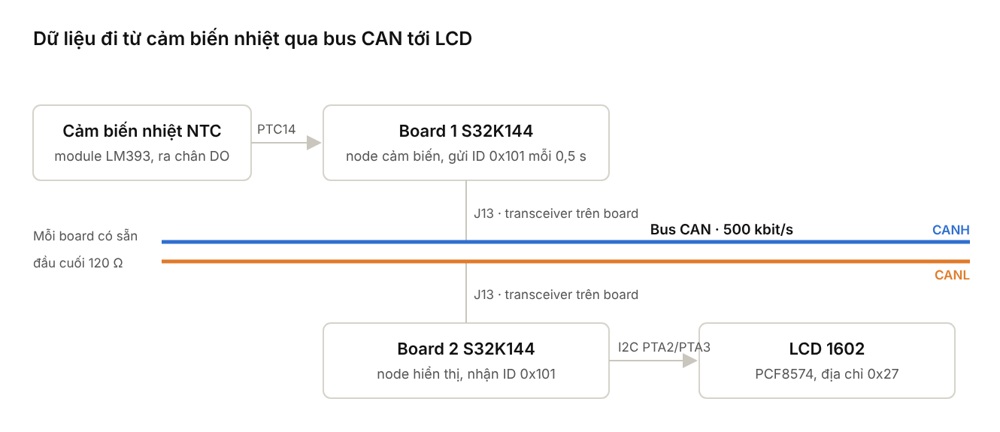
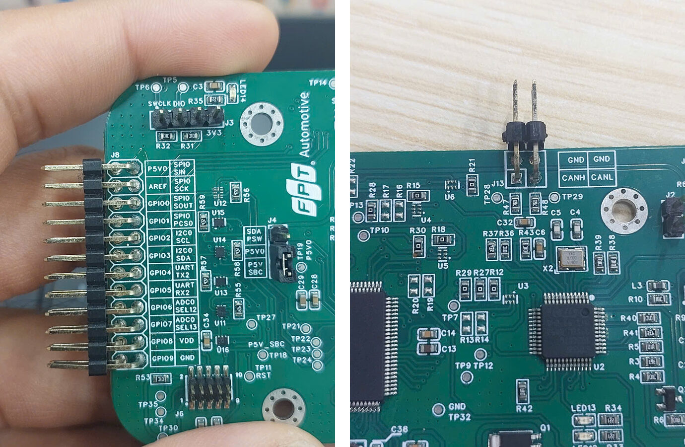
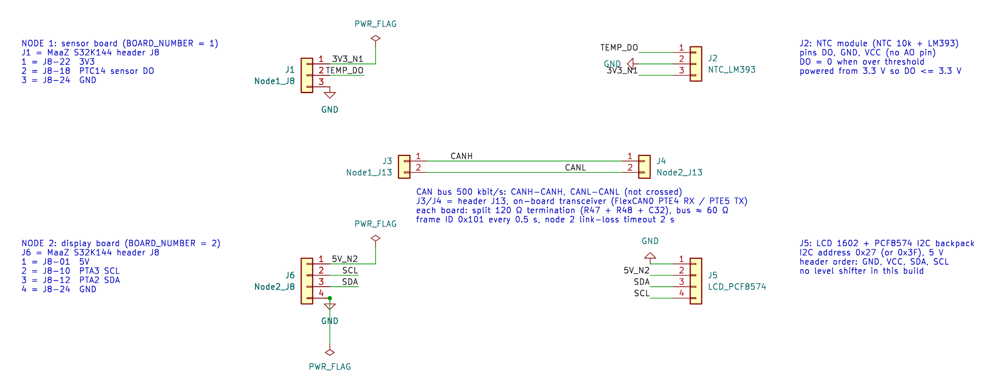
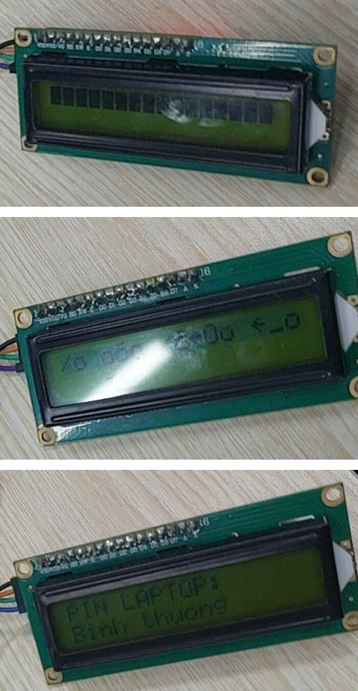

# S32K144 CAN Battery-Overheat Alert

Two NXP S32K144 boards talk over a **CAN bus at 500 kbit/s**. Node 1 reads an NTC temperature sensor and broadcasts the laptop-battery state every 0.5 s. Node 2 receives the frame and shows the state on an I2C LCD 1602. If the bus goes silent for 2 s (cable pulled, node 1 off), node 2 shows a link-loss error instead of a stale value.

Course lab PEB301, FPT University HCMC. Author: Tran Duc Kien.



**Demo video:** [Google Drive](https://drive.google.com/file/d/14YYAwOOJtpj6ggqt1ud4QlMsAI427d97/view?usp=sharing)

## Highlights

- FlexCAN bit timing set by hand: 8 MHz oscillator, 16 tq per bit, 500 kbit/s, 87.5 % sample point.
- One `main.c` for both nodes, selected by `BOARD_NUMBER`, so both boards always share the same CAN configuration.
- Hardware acceptance filter: node 2's message buffer accepts only ID `0x101`.
- Link-loss detection with a 2 s receive timeout (node 1 sends every 0.5 s).
- Sensor debounce: the state changes only after 3 identical reads 100 ms apart.
- Bring-up in verified steps: loopback on one board, then two boards, then sensor and LCD.
- Own LCD 1602 driver over PCF8574 (`src/lcd1602_i2c.c`), 4-bit mode.

## Hardware

| Part | Qty | Role |
|---|---|---|
| MaaZ Edu board (NXP S32K144, Cortex-M4F, on-board CAN transceiver) | 2 | Node 1 sensor, node 2 display |
| NTC module with LM393 comparator (digital DO output) | 1 | Over-temperature switch on node 1 |
| LCD 1602 + PCF8574 I2C backpack (0x27 / 0x3F) | 1 | Display on node 2 |



### Wiring

| Signal | Node 1 | Node 2 | Note |
|---|---|---|---|
| CANH | J13 left | J13 left | CANH to CANH, not crossed |
| CANL | J13 right | J13 right | CANL to CANL |
| GND | J8-24 | J8-24 | Common ground |
| Sensor DO | J8-18 (PTC14) | — | Module powered from 3.3 V VDD |
| I2C SCL / SDA | — | J8-10 (PTA3) / J8-12 (PTA2) | LPI2C0, 100 kHz |
| LCD power | — | J8-01 (5 V) | |

Each board already has a split 120 Ω termination (R47 + R48 = 2 × 60.4 Ω via C32), so two boards give about 60 Ω between CANH and CANL with power off. No external resistor is needed.



### Schematic

Drawn in KiCad 10 (`hardware/`). Each board is drawn as connectors with only the pins that are used (header J8 and the CAN header J13); the notes give the real J8 pin numbers. The CAN transceiver and the 120 Ω termination are on the boards, so they appear only as notes. ERC passes with 0 errors.



[Schematic PDF](hardware/can_battery_alert.pdf)

## CAN configuration

| Parameter | Value |
|---|---|
| Instance | CAN0 (PTE4 RX, PTE5 TX) |
| Mode | Normal (loopback for step 1) |
| Clock | 8 MHz external oscillator, prescaler 1 → tq = 125 ns |
| Segments | Sync 1 + Prop 8 + Phase1 5 + Phase2 2 = 16 tq |
| Bitrate | 8 MHz / 16 = **500 kbit/s** |
| Sample point | (1 + 8 + 5) / 16 = **87.5 %** |
| Message buffers | MB0 receive, MB1 transmit, CAN 2.0 (FD off) |

### Frame `0x101` (DLC 8)

| Byte | Content |
|---|---|
| 0 | Battery state: 0 = normal, 1 = overheat |
| 1 | Frame counter (proves node 1 is alive) |
| 2 | Raw DO level (debug) |
| 3–7 | Reserved, 0 |

## Behaviour

| Situation | LCD on node 2 | LED02 |
|---|---|---|
| Normal | `PIN LAPTOP: / Binh thuong` | Both nodes blue |
| Probe heated (DO-LED on) | `PIN LAPTOP: / QUA NONG!` | Node 2 red |
| CAN wire pulled or node 1 off | `Mat ket noi CAN / Kiem tra CANH/L` after ~2 s | Both red |

The LCD reacts about 1 s after the DO-LED lights: 0.3 s debounce plus up to 0.5 s until the next frame.

## Test steps

| Step | What | Result |
|---|---|---|
| 1 | FlexCAN loopback on one board, 8-byte frame every 0.5 s | Pass: 146 frames OK, 0 errors |
| 2 | Two boards on J13, each sends a counter (IDs 0x101 / 0x102) | Pass: blue on both; red with one board alone (no ACK) |
| 3 | Enable transceiver over SPI (fallback) | Not needed |
| 4 | Full application with sensor and LCD | Pass |

## Problems found and fixed

| Symptom | Cause | Fix |
|---|---|---|
| Bitrate showed 83.333 kbit/s | Default prescaler 5 | Prescaler 0 → 500 kbit/s |
| LED purple/red while loopback passed | LED02 is active-low; PTD16 is blue | Fixed LED logic, checked with debug variables |
| LCD shows one row of black boxes | LCD powered but never initialised | Check SDA/SCL, GND, 5 V; reset node 2 after LCD is powered |
| Garbage characters on LCD | One failed I2C transfer shifts the 4-bit nibble order | Write only on change, re-initialise LCD every ~5 s |
| DO-LED on but LCD stays "normal" | DO wired to PTC15 while code reads PTC14 | Moved wire to J8-18 |
| Build error `NUM_OF_CONFIGURED_PINS0` | No pins configured yet in step 1 | Call `PINS_DRV_Init()` only from step 2 |



## Project layout

```
src/        main.c (both nodes), lcd1602_i2c.c/.h
board/      code generated by S32 Config Tools (clock, pins, FlexCAN, I2C PAL, OSIF)
CAN_bus.mex S32 Config Tools project (pins and peripherals)
Project_Settings/  linker scripts, startup code, debug launch files
hardware/   KiCad schematic (can_battery_alert.kicad_sch) and PDF export
```

## Build

1. S32 Design Studio 3.5 with **S32 SDK S32K1xx RTM 4.0.1**. The SDK is not included in this repo.
2. File → Import → Existing Projects into Workspace, select this folder.
3. Open `CAN_bus.mex`, Update Code so the SDK files are attached.
4. Set `BOARD_NUMBER` in `src/main.c` (1 = sensor node, 2 = LCD node), build, flash with `CAN_bus_Debug_FLASH`.
5. Repeat for the other board with the other `BOARD_NUMBER`.

## Next steps

- Read the NTC divider with the ADC to show °C and several alarm levels.
- Add a third node (buzzer) on the same bus.
- Add a 3.3 V ↔ 5 V level shifter for the LCD for long-term stability.
